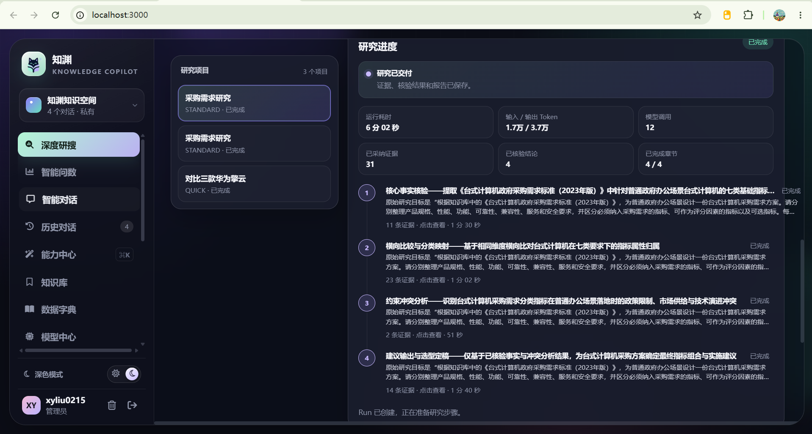
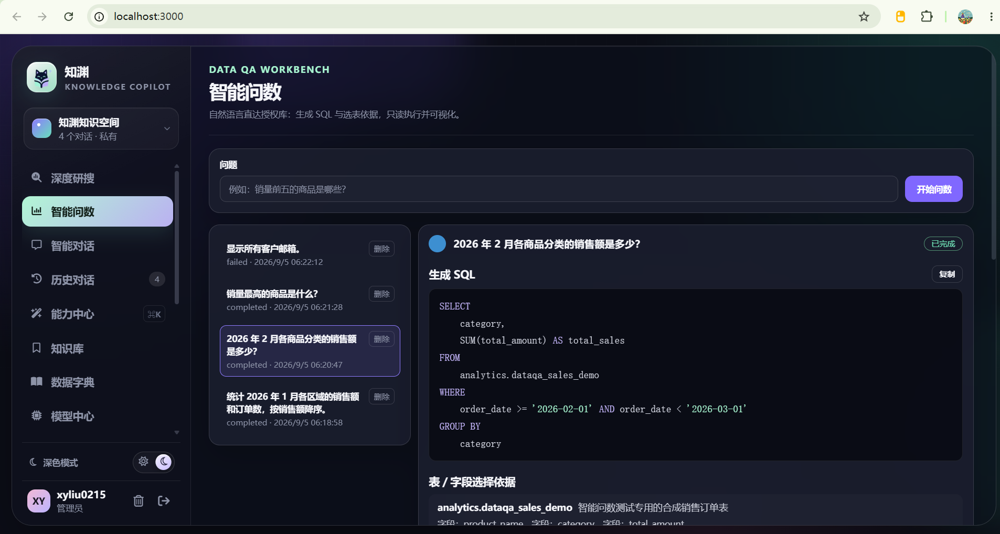
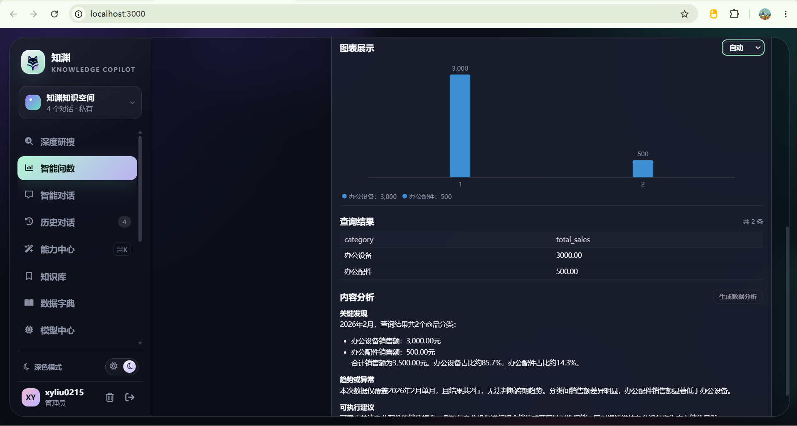
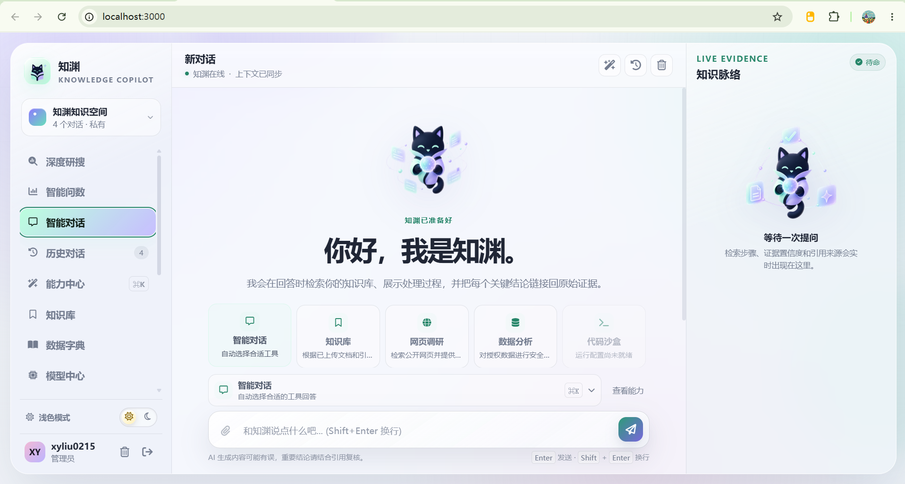
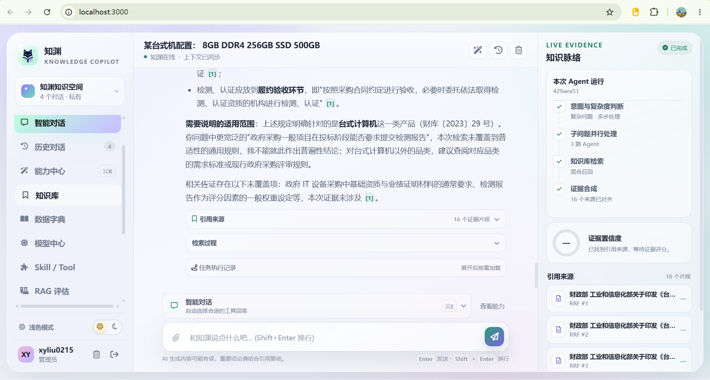

# 知渊（ZhiYuan）

> 一个面向真实业务的、可追溯的 Agentic RAG 智能知识库和数据分析平台。

知渊将知识库问答、网页调研、深度研究、智能问数、模型治理与 RAG 评测收敛到同一套持久化执行体系。系统不把一次对话当作一次临时 HTTP 请求：每个任务都有可恢复的 **Thread**、可审计的 **Run / Event**、可继续的 **Checkpoint**、不可变的 **Document Version** 与冻结的 **Model Snapshot**。

这使得用户可以查看一次回答或一份研究报告从哪里来、调用了哪些能力、收集了哪些证据、为什么发生降级，并在浏览器刷新、网络中断或人工审批后继续同一个任务。

## 功能一览

| 模块 | 能力 |
| --- | --- |
| 智能对话 | 结合知识库、网页调研、SQL 与受控工具完成多轮问答，并展示证据、检索过程与运行状态。 |
| 知识库 | 上传文档、异步解析、版本化索引和检索；支持密集向量、BM25、自动合并与可选重排。 |
| 深度研搜 | 创建研究项目、生成并审批计划、多步搜证与核验、章节写作、报告编辑和 Markdown/PDF 交付。 |
| 智能问数 | 从自然语言生成受控只读 SQL，展示表/字段选择依据、结果表格、图表与分析建议。 |
| 模型中心 | 管理无 Secret 的 Model Profile，分配 Answer、Fast、Grader、Evaluator 角色。 |
| RAG 评估 | 基于版本化数据集创建持久化评测任务，记录 Case、指标、Gate 与趋势。 |
| 能力中心 | 管理 Skill、Tool、网页调研开关、审批要求及隔离 Sandbox 能力。 |

## 产品界面

### 深度研搜：计划审批后的多步研究交付

研究任务会展示运行耗时、输入/输出 Token、模型调用次数、采纳证据、核验结论和已完成章节。每个研究步骤保留问题、来源、证据数量和执行状态，研究结果可以继续审阅与导出。



### 智能问数：从自然语言到受控 SQL

用户用自然语言提出业务问题后，系统选择已授权的数据表和字段，生成只读 SQL 并呈现其依据。查询历史会保留每次问数任务及其状态。



### 智能问数：图表、结果表与分析建议

查询完成后可以切换图表类型，查看原始结果表，并获得面向业务的关键发现、趋势说明和后续建议。



### 智能对话：能力入口与证据驱动回答

首页集中展示智能对话、知识库、网页调研、数据分析与代码沙盒等能力；用户可在同一会话中选择可用能力发起任务。



完成回答会保留 Agent 执行阶段、检索方式、证据合成情况、引用来源与可展开的执行记录，便于复核答案而不是只查看最终文本。



## 为什么选择知渊

### 面向持久运行，而不是一次性调用

一次 Agent 执行会先创建 Run，随后所有进度、消息增量、工具调用、检索过程、审批请求和终态事件都写入 Event Journal。前端通过 SSE 获取这些事件，并可按 sequence 重放。关闭浏览器或网络中断只会停止观察，不会把正在运行的任务误判为取消。

### 研究结论可复核

深度研搜不会直接生成一篇无法验证的长文。它先产生研究计划，用户批准后再运行；每个步骤都以当前项目选定的知识库与网页证据为输入，输出核验结论、章节和交付物。报告中的引用与证据身份可回溯，来源异常和能力降级会被明确记录。

### 模型与配置可治理

模型中心将模型地址、模型标识、超时和能力声明保存为 Model Profile。API Key 始终只保留在服务端环境中。新 Run 和 RAG 评测任务创建时冻结完整 Model Snapshot，因此配置改动不会改变已经运行、重试或等待人工输入的任务。

### 安全边界前置

系统将能力可见性、工具授权、审批、网络访问、SQL 权限和沙盒隔离拆分为明确边界。网页内容只能以当前 Run 已验证的 Evidence 身份进入后续流程；SQL 助手必须使用独立只读账号；Sandbox 只运行已获准且满足资源限制的代码。

## 核心工作流

### 知识库问答

1. 上传文件后，API 创建持久化 Index Job。
2. Indexing Worker 解析文档、分块、生成 Embedding 并写入候选索引。
3. 校验成功后，Document Version 以原子方式发布为当前版本。
4. 对话 Run 使用该版本完成检索、证据判断、回答生成与引用展示。

### 深度研搜

1. 创建 Quick、Standard 或 Deep 研究项目，并选择知识库、网页来源和附件。
2. 系统生成研究计划；用户在界面批准后，才会创建实际的 Research Run。
3. Agent 按计划执行多步骤检索、证据采集、事实核验和章节写作。
4. 运行完成后，用户可预览、编辑、版本化保存报告并下载 Markdown/PDF 交付物。

### 智能问数

1. 管理员使用独立只读数据库账号配置允许访问的 Schema、表和字段元数据。
2. 用户提交业务问题，系统生成受策略约束的只读 SQL。
3. SQL Adapter 执行预算、超时、对象范围和敏感字段检查。
4. 前端展示 SQL、字段选择依据、表格、图表和分析结果。

## 架构

```text
┌──────────────── Vue 3 + TypeScript 前端 ────────────────┐
│  对话 / 知识库 / 深度研搜 / 智能问数 / 控制面 / 评测工作台 │
└───────────────────────┬─────────────────────────────────┘
                        │ HTTP / SSE
┌───────────────────────▼─────────────────────────────────┐
│ FastAPI API                                                │
│  Auth · Thread · Run · Event · Model Control · Capability │
└───────┬───────────────────┬───────────────────┬──────────┘
        │                   │                   │
        ▼                   ▼                   ▼
 PostgreSQL              Redis               Milvus
 Thread / Run / Event    通知 / 限流 / 取消     向量 / 稀疏索引
 Checkpoint / Snapshot
        │
        ├── Indexing Worker：文档解析、分块、Embedding、索引发布
        ├── Evaluation Worker：RAG 数据集、Case 与报告评测
        └── Provider Runtime：模型调用、检索、重排、Tavily 网页调研
```

后端使用 Python 3.12、FastAPI、Pydantic、SQLAlchemy、LangChain/LangGraph；前端使用 Vue 3、TypeScript、Pinia、Axios 与 Vite。基础设施包括 PostgreSQL、Redis、Milvus、etcd 与 MinIO。

## 关键领域对象

| 对象 | 作用 |
| --- | --- |
| Thread | 连续对话容器，拥有用户与助手消息的顺序。 |
| Run | 一次持久化 Agent 执行，绑定用户、Thread、幂等键、用户消息和助手消息。 |
| Event | Run 的版本化事实日志；SSE 只是其可恢复投影。 |
| Checkpoint | 支持人工审批、补充输入和中断恢复的执行检查点。 |
| Document Version | 不可变的文档内容与索引版本，失败构建不会污染当前可检索版本。 |
| Model Profile / Snapshot | 无 Secret 的模型配置，以及 Run 创建时冻结的模型角色快照。 |
| Evidence | 绑定到当前 Run 的已验证证据身份，用于引用、核验和网页内容访问。 |

更完整的术语和关系请阅读 [CONTEXT.md](CONTEXT.md)。

## 快速开始

### 环境要求

- Python 3.12+
- [uv](https://docs.astral.sh/uv/)
- Node.js 20.19+ 与 npm 10+
- Docker 与 Docker Compose

### 1. 创建本地配置

```bash
cp .env.example .env
```

至少填写以下配置。模型值只用于首次初始化控制面默认值，之后可在模型中心维护。

```dotenv
ARK_API_KEY=your_api_key
MODEL=your_answer_model
FAST_MODEL=your_fast_model
GRADE_MODEL=your_grader_model
EVALUATION_MODEL=your_evaluator_model
BASE_URL=https://your-llm-endpoint/v1
JWT_SECRET_KEY=replace-with-a-random-secret-of-at-least-32-characters
```

启用网页调研时，还需要配置 Tavily：

```dotenv
TAVILY_API_KEY=your_tavily_api_key
```

`.env` 包含密钥，禁止提交到 Git。

### 2. 启动基础设施并安装依赖

```bash
docker compose up -d
docker compose ps

uv sync --frozen

cd frontend
npm ci
npm run build
cd ..

uv run --frozen alembic upgrade head
```

开发 Compose 只负责 PostgreSQL、Redis、etcd、MinIO、Milvus 和 Attu；应用进程由下一步的启动器管理。

### 3. 启动应用

Windows PowerShell：

```powershell
uv run --frozen python -m backend.launcher
```

启动器会同时管理 API、Indexing Worker 和 RAG Evaluation Worker。启动后访问 <http://127.0.0.1:8000>。

### 4. 检查运行状态

```bash
curl --fail --silent --show-error http://127.0.0.1:8000/health/live
curl --fail --silent --show-error http://127.0.0.1:8000/health/ready
```

`/health/ready` 会校验数据库、Redis、Milvus、Embedding、网页检索配置、Sandbox（启用时）和当前构建版本的 Indexing Worker。

## 主要配置

| 配置项 | 说明 |
| --- | --- |
| `RUN_DEADLINE_SECONDS` | 普通 Run 的总截止时间，默认 600 秒。深度研究使用各自冻结的 Profile 预算。 |
| `TAVILY_API_KEY` | Tavily SDK 的服务端密钥，用于网页调研。 |
| `DATABASE_URL` / `REDIS_URL` | PostgreSQL 持久化事实与 Redis 通知、限流、取消通道。 |
| `MILVUS_HOST` / `MILVUS_PORT` | 向量和稀疏检索服务地址。 |
| `SQL_ASSISTANT_*` | 只读 SQL 数据源、授权范围、超时和结果预算。 |
| `SANDBOX_*` | 代码沙盒镜像、资源限制与运行时边界。 |
| `INDEX_WORKER_*` / `EVALUATION_WORKER_*` | 文档索引与 RAG 评测 Worker 的轮询、租约和并发参数。 |

完整变量及默认值见 [.env.example](.env.example)。

## 开发与质量检查

```bash
# 后端：测试与静态检查
uv run --no-sync pytest -q
uv run --no-sync ruff format --check .
uv run --no-sync ruff check .
uv run --no-sync mypy

# 前端：单元测试、类型检查与构建
cd frontend
npm run test:unit
npm run typecheck
npm run build:check
```

涉及跨端 Run Event 合约时，修改 [contracts/](contracts/) 中的真源并运行生成检查；不要直接编辑 `generated/` 类型文件。涉及迁移、部署、评测或安全策略时，请按对应 Runbook 执行完整门禁。

## 项目目录

```text
backend/       FastAPI、Agent Runtime、RAG、Run/Event、Worker、认证与控制面
frontend/      Vue 3 前端、Pinia Store、SSE 投影与 Playwright E2E
contracts/     版本化 Run Event 与 Tool Result Contract 真源
migrations/    Alembic 前向迁移
evals/rag/     RAG 数据集、Observation、Gate 与基线资产
docs/adr/      架构决策记录
docs/runbooks/ 开发、部署、研究、评测与安全运维手册
```

## 安全与运行原则

- API Key、DSN 密码和原始凭据不会写入 Model Profile、Run、Event、Checkpoint、评测报告或前端状态。
- Provider 失败不会被伪装为“没有知识”；检索、重排和网页调研的降级状态会显式记录。
- 每个 Run 的队列、超时、证据、模型快照与能力上下文相互隔离，避免并发任务串号。
- 修改模型角色和能力配置只影响之后创建的 Run 与评测任务；已有任务继续使用已冻结的快照。
- SQL 助手仅接受独立只读账号，网页访问和 Sandbox 执行都遵循受控授权边界。

## 文档

- [领域术语与对象关系](CONTEXT.md)
- [架构决策记录](docs/adr/)
- [部署 Runbook](docs/runbooks/deployment.md)
- [深度研搜 Runbook](docs/runbooks/research-workbench.md)
- [网页调研 Runbook](docs/runbooks/web-research.md)
- [Sandbox 与 Guardrail Runbook](docs/runbooks/guardrails-and-sandbox.md)
- [RAG 评测资产说明](evals/rag/README.md)

## 许可证

本项目采用 [MIT License](LICENSE)。
